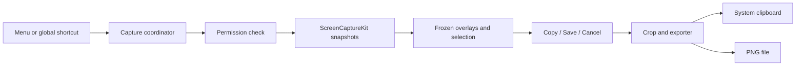
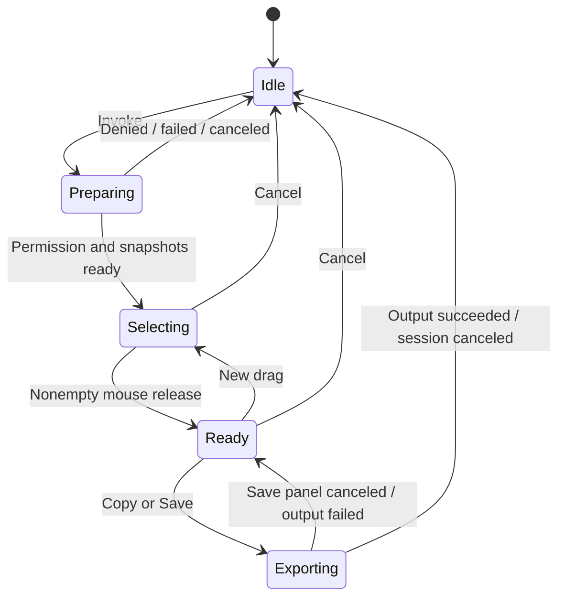

# Milestone 1 — fast Mac screenshot capture

## Goal Capsule

**Objective:** A Mac user can invoke Snap, select a rectangular area, and copy or save exactly what they selected with minimal delay.

**Means:** Native menu bar app with on-demand capture and a frozen-image selection overlay (KTD1–KTD4).

**Authority:** The user's instructions and approved milestone scope govern this plan. Requirements own behavior; technical decisions own implementation choices. Proposed defaults are identified under Assumptions.

**Execution profile:** Local implementation and verification on macOS. Deliver a runnable development `.app` and setup instructions. Commits, remote publication, App Store submission, and production distribution are separate actions.

**Stop conditions:** Surface an unavailable development prerequisite, OS behavior that prevents the agreed capture flow, or a required scope change. Do not report permission-dependent or GUI behavior as verified from unit tests alone.

## Product Contract

### Summary

Build the first complete capture loop: invoke, select, copy or save, and return to the previous app. Annotation and online sharing remain later milestones.

### Problem Frame

The product's value depends on how quickly someone can capture what they are looking at. A slow overlay, an inaccurate crop, or an intrusive editor would undermine that goal before drawing or upload features matter.

### Requirements

- **R1. Menu bar presence:** Snap runs with a menu bar icon and no Dock icon or normal main window. Its menu exposes Take Screenshot, screen permission help, and Quit.
- **R2. Invocation:** A global shortcut and Take Screenshot start the same capture flow while another app is active. If registration fails, explain the conflict and keep menu invocation available. Repeated invocation must not create overlapping sessions.
- **R3. Permission:** Explain and request Screen Recording access when needed. Denial or revocation must leave a usable menu bar app with guidance to macOS settings. Check access again on invocation; a grant may require relaunch on some supported systems.
- **R4. Frozen overlay:** Capture the desktop before presenting Snap's overlay or activating its capture UI. Show frozen screen images with dimming and a crosshair; do not include Snap's overlay, toolbar, or mouse cursor in the exported image.
- **R5. Selection:** Click and drag a rectangular region in any direction. During the drag, that region shows the undimmed frozen image. On release, a nonempty selection enters the ready state and shows an adjacent toolbar.
- **R6. Toolbar:** Offer Copy Image, Save PNG, and Cancel. Keep controls within the selected display's usable bounds, placing them inside the selection when there is insufficient outside space. Retain the visible selection until an output action succeeds or the user cancels.
- **R7. Copy:** Put the cropped image on the system clipboard. On success, dismiss the capture UI and return focus to the app that was active before invocation.
- **R8. Save:** Open the native save panel with a suggested timestamp-based PNG filename. Save the cropped image at its captured pixel resolution. A canceled panel returns to the selection; a failed write reports the error and preserves the selection for retry. Successful save ends the session.
- **R9. Cancel and cleanup:** Escape or Cancel dismisses capture without changing the clipboard or writing a file. A click without a nonempty drag leaves the overlay ready for selection. Release captured image buffers and remove all capture windows when a session ends.
- **R10. Accurate export:** Clipboard and saved images contain the selected desktop pixels, with no dimming, selection border, or toolbar. Preserve Retina resolution through explicit point-to-pixel conversion.

### Key Decisions

- **Capture first, annotation second:** Milestone 1 delivers the standalone capture loop; the user approved this sequence after reviewing the three milestones. Governs R1–R10.
- **Later sharing is viewable by anyone with the link** (session-settled: user-directed — chosen over private uploads or separate sharing actions: the user explicitly selected this behavior). This constrains milestone 3 only; milestone 1 adds no Google sign-in, upload, or sharing controls.

### Acceptance Examples

- **AE1:** While another app is active, invoke Snap, drag from bottom-right to top-left, and release. The selected image is clear and the toolbar appears without opening a separate editor.
- **AE2:** Select a 200×100-point area on a display whose captured image maps to two pixels per point. Copy and PNG export both produce the same 400×200-pixel crop.
- **AE3:** Cancel the save panel. The original frozen selection remains available; choose Copy without taking a second screenshot.
- **AE4:** Press Escape while capture is still preparing. The session ends and late capture results never display an overlay.
- **AE5:** Deny Screen Recording permission. Snap remains in the menu bar, shows useful guidance, and can capture after permission is granted and any required relaunch completes.

### Scope Boundaries

This pass delivers R1–R10. It creates no annotation data or uploaded-image history.

#### Deferred to Follow-Up Work

- Milestone 2: freehand drawing, arrows, shapes, text comments, color selection, undo/redo.
- Milestone 3: Google OAuth, dedicated Drive folder, upload, anyone-with-link permissions, copied links, screenshot gallery.
- Configurable shortcut, launch at login, saved preferences, capture resizing/moving, and selection spanning displays are follow-up candidates. The defaults below do not establish permanent product exclusions.
- Distribution signing, notarization, installer, automatic updates, and Mac App Store packaging.

No continuous screen recording, app backend, telemetry service, or generalized plugin architecture is needed for this pass. Reconsider continuous capture only if measured invocation latency cannot meet an acceptable target with on-demand capture.

## Planning Contract

### Assumptions and Proposed Defaults

These are implementation defaults proposed by this plan, rather than additional user-confirmed product choices.

- Support macOS 14 and later to use the original ScreenCaptureKit screenshot API; verify deployment availability against the installed SDK during implementation.
- Use **Command–Shift–7** as the initial shortcut (user-directed change before implementation). Shortcut customization is deferred; an unavailable registration must be visible per R2.
- Show an overlay on each connected display, with selection confined to the display where the drag starts. Users can select on any display; spanning multiple displays is deferred. Clamp the drag to the starting display.
- Clicking and dragging again in the ready state replaces the selection. Selection handles and moving the existing rectangle are deferred.
- Export standard SDR PNG images for predictable clipboard and file viewing; HDR output is deferred.
- Proposed speed budget on the development Mac: warm shortcut-to-visible-overlay p95 ≤300 ms and release-to-toolbar p95 ≤50 ms, measured over 30 invocations on a single display. Measure cold invocation and multiple-display timings separately. These targets are unverified; report actual results and discuss any material miss rather than hiding it with a stale screenshot.

### Environment and Prerequisites

The workspace is empty and is not yet a Git repository. There are no existing source patterns, tests, or package constraints to preserve.

Swift 6.4 is available. `xcodebuild -version` currently fails because the active developer directory is Command Line Tools. Before building the app and running its tests, locate an installed full Xcode or arrange its installation and select it. This prerequisite blocks build verification, not planning or source creation. Do not install developer tools as a hidden step.

Use a stable app bundle identifier and consistent development signing so permission checks refer to the same application between builds. Verify actual permission persistence during development; do not promise it from signing configuration alone.

### Key Technical Decisions

- **KTD1. Native app target:** Create a checked-in `Snap.xcodeproj` with a shared Snap scheme, an app target, and XCTest target. Use Swift with AppKit for status bar and capture windows. Set `LSUIElement` for agent-style behavior. Prefer built-in frameworks and no third-party dependencies. SwiftUI can serve later settings/history screens; this pass does not need it. [Apple: LSUIElement](https://developer.apple.com/library/archive/documentation/General/Reference/InfoPlistKeyReference/Articles/LaunchServicesKeys.html).
- **KTD2. On-demand screenshot:** Use `SCScreenshotManager.captureImage(contentFilter:configuration:)` with display content filters. Capture each display at its pixel dimensions before ordering any overlay windows onscreen. Freeze those images for the whole session; output is a crop of them, never a recapture after selection. Suppress cursor capture and request SDR where supported. [Apple screenshot API overview](https://developer.apple.com/videos/play/wwdc2023/10136/).
- **KTD3. Session owner:** One main-actor coordinator owns capture state, previous-app identity, overlay windows, and toolbar. Capture and encoding work must not block mouse interaction. Use session identity to discard callbacks after cancellation or a newer session; propagate failure to a visible message and clean up.
- **KTD4. Geometry from actual images:** Store each display's global AppKit frame and captured image dimensions. Keep selection in display-local logical points; map to image pixels using actual width/height ratios and explicit vertical-axis conversion. Normalize reversed drags, round outward to pixel bounds, and clamp to the bitmap. Do not assume every display shares one scale or has a positive origin.
- **KTD5. Global shortcut registration:** Use `RegisterEventHotKey` behind a small owner that unregisters on teardown. Avoid event taps and broad keyboard monitoring for this single shortcut. Check registration errors rather than assuming success. [Apple discussion of registration constraints](https://developer.apple.com/forums/thread/763878).
- **KTD6. Fullscreen and focus:** Use borderless AppKit capture panels with appropriate all-Spaces/fullscreen-auxiliary behavior. Allow keyboard focus for Escape and output actions. Capture before activation; restore the prior running application when finishing if it is still available. Fullscreen behavior must be verified on real macOS sessions.
- **KTD7. Output boundary:** A small exporter receives the immutable snapshot plus selection and produces one cropped image for both clipboard and PNG. Use `NSPasteboard`, ImageIO, and `NSSavePanel`; encode away from the main actor. No database or screenshot persistence before explicit Save.

### High-Level Technical Design

An output already written or copied cannot be rolled back by canceling afterward. Disable duplicate output actions during export. Cancellation before an output side effect prevents it; late callbacks cannot reopen UI. Canceling a save panel follows R8.

### Risks and Deferred Runtime Checks

- Screen Recording permission prompts and relaunch behavior differ across supported OS versions. Follow the system's actual response rather than repeatedly prompting.
- Display discovery and capture can dominate latency. Measure them separately before considering caching display metadata; never cache old screenshot pixels across invocations.
- Mixed scaling, negative display origins, and image orientation are correctness risks addressed through pure geometry tests and real display verification.
- Display disconnection or layout changes invalidate a session. Cancel cleanly and let the user invoke again instead of exporting against changed geometry.
- Secure or protected content may not be capturable. Preserve OS behavior; do not attempt a bypass or promise capture of protected surfaces.

## Implementation Units

### U1. Runnable menu bar app

**Goal:** Establish a development app that stays out of the Dock and responds to the shared invocation path.

**Requirements:** R1, R2. **Dependencies:** Full Xcode for build verification.

**Files:** `Snap.xcodeproj/project.pbxproj`, `Snap.xcodeproj/xcshareddata/xcschemes/Snap.xcscheme`, `Snap/Info.plist`, `Snap/AppDelegate.swift`, `Snap/StatusBarController.swift`, `Snap/GlobalShortcut.swift`, `SnapTests/GlobalShortcutTests.swift`, `README.md`, `.gitignore`.

**Approach:** Wire a status item and registered shortcut to a single capture command. Establish the bundle identity and development build settings. Document launch and permission setup. Follow KTD1 and KTD5; there is no existing project pattern.

**Test scenarios:**

- A successful shortcut registration invokes the capture command once.
- A failed registration yields a visible explanation and retains menu invocation.
- Shortcut ownership releases registration on teardown.

**Verification:** Launch the `.app`; confirm one menu icon, no Dock icon, menu invocation, global invocation from another app, and Quit. Use a runtime smoke check for packaging rather than tests of plist contents.

### U2. Permission and frozen capture session

**Goal:** Obtain fresh display snapshots safely and manage session lifetime.

**Requirements:** R3, R4, R9; AE4, AE5. **Dependencies:** U1.

**Files:** `Snap/CaptureCoordinator.swift`, `Snap/ScreenCaptureService.swift`, `Snap/ScreenPermission.swift`, `Snap/DisplaySnapshot.swift`, `SnapTests/CaptureCoordinatorTests.swift`.

**Approach:** Apply KTD2–KTD3. Separate OS capture from state transitions with narrow injectable dependencies for tests. Check permission without blocking repeated prompts. Collect images before showing panels. Track a session identity and release buffers on end.

**Test scenarios:**

- Denied permission produces guidance without an overlay.
- Successful preparation exposes only fresh snapshots from this invocation.
- Repeated invocation during preparation does not create a second session.
- Covers AE4: cancel before capture completes; late success cannot show UI.
- Capture failure or display change returns to idle and releases session images.

**Verification:** Exercise actual permission denial, grant, required relaunch, and revocation. Confirm overlays are absent from captured source images. Document OS-specific results.

### U3. Selection overlay and ready toolbar

**Goal:** Deliver the drag interaction with accurate geometry and immediate toolbar presentation.

**Requirements:** R5, R6, R9, R10; AE1, AE2. **Dependencies:** U2.

**Files:** `Snap/CaptureOverlayPanel.swift`, `Snap/CaptureOverlayView.swift`, `Snap/SelectionGeometry.swift`, `Snap/CaptureToolbar.swift`, `SnapTests/SelectionGeometryTests.swift`, `SnapTests/CaptureCoordinatorTests.swift`.

**Approach:** Apply KTD4 and KTD6. Draw the frozen image with a dimmed mask outside selection. Keep geometry independent of AppKit event handling for deterministic tests. Present the toolbar from the already available image, without recapturing or encoding.

**Test scenarios:**

- Covers AE1: reversed drag yields the expected normalized rectangle.
- Covers AE2: 200×100 points mapped at 2× yields the expected pixel rectangle.
- Validate 1×, fractional conversion, bounds clamping, negative display origins, and vertical-axis mapping using fixtures with distinguishable corner pixels.
- Zero-area release keeps the session selectable; a new drag replaces an existing selection.
- Toolbar placement stays onscreen for selections at each display edge and for a tiny selection.
- Escape dismisses every overlay and restores focus once.

**Verification:** Test on primary and secondary displays, mixed Retina scaling, displays positioned left/above, and fullscreen apps. Confirm no dimming or toolbar is baked into the selected image. Mark unavailable hardware combinations unverified.

### U4. Clipboard and PNG output

**Goal:** Finish the useful capture loop with reliable copy/save behavior.

**Requirements:** R7–R10; AE2, AE3. **Dependencies:** U3.

**Files:** `Snap/ScreenshotExporter.swift`, `Snap/SaveScreenshotController.swift`, `SnapTests/ScreenshotExporterTests.swift`, `SnapTests/CaptureCoordinatorTests.swift`.

**Approach:** Apply KTD7. Crop once from the selection, use that image for both destinations, and honor export-state rules in the technical design. Retain the selection when an output fails. Complete focus restoration and session cleanup only after success or cancellation.

**Test scenarios:**

- Covers AE2: clipboard payload and decoded PNG have matching dimensions and selected fixture pixels.
- Covers AE3: canceled save returns to ready with the same snapshot and crop.
- A write failure preserves the selection and permits retry.
- Duplicate output clicks do not write twice or complete twice.
- Cancel before an asynchronous output side effect prevents that side effect and late UI changes.
- Copy or save success releases the session; cancel changes neither clipboard nor filesystem.

**Verification:** Paste into another native app, inspect the saved PNG dimensions, and compare image content. Exercise save cancellation and a real unwritable destination.

### U5. Measure and verify the complete loop

**Goal:** Establish whether the implemented interaction meets the product's speed intent.

**Requirements:** R1–R10; AE1–AE5; proposed speed budgets. **Dependencies:** U1–U4.

**Files:** `Snap/CaptureCoordinator.swift`, `SnapTests/CaptureCoordinatorTests.swift`, `README.md`, `docs/verification/milestone-one.md`.

**Approach:** Add local signposts for invocation, image readiness, overlay presentation, selection release, and toolbar presentation. Use Instruments and visual checks together; an order-window call alone does not prove the frame appeared. No remote telemetry. Keep a record of machine, OS, display configuration, timings, permission behavior, and unverified cases.

**Test scenarios:**

- Rapid repeated invocation and cancellation never leave a stale overlay.
- After 30 completed/canceled sessions, capture windows and image ownership return to baseline.
- Delayed or failed capture produces no stale-image overlay.

**Verification:** Run the proposed timing sample; measure cold invocation separately. If latency misses materially, attribute the slow stage and improve it within the on-demand design before proposing a different capture strategy.

## Verification Contract

- Create a shared Snap scheme with its XCTest target. After full Xcode is selected, use `rtk xcodebuild -project Snap.xcodeproj -scheme Snap -configuration Debug -destination 'platform=macOS' build` and the equivalent `test` action. These are planned commands; neither the project nor test target exists yet.
- Pure tests prove state transitions, geometry, crop pixels, and error paths. Use temporary file fixtures and injected output boundaries; do not mutate the real clipboard in unit tests.
- Manual verification proves menu bar behavior, global shortcut, Screen Recording permission, fullscreen presentation, focus restoration, clipboard interoperability, save panel behavior, and actual rendered latency.
- Verification requires user-authorized GUI interaction during implementation. Do not claim a unit test or successful build proves the desktop workflow.
- Record measured speed and hardware/OS coverage in `docs/verification/milestone-one.md`. At minimum, test the current development Mac. macOS 14 and other display configurations remain unverified until exercised on available hardware or OS environments.

## Definition of Done

- U1–U4 satisfy their requirements and verification outcomes, and U5 records timing results and coverage.
- The development `.app` launches, takes a fresh rectangular screenshot, copies or saves the correct pixels, and returns control to the previous app.
- Automated checks pass; manual checks are completed or explicitly identified as blockers/unverified limitations.
- No Google, upload, drawing, or placeholder toolbar features enter this pass.
- Setup and permission instructions are reproducible; abandoned experiments are removed.
- Any unmet proposed speed target is disclosed with measured evidence and an explicit disposition before calling milestone 1 complete.

## Sources

- [Lightshot reference](https://app.prntscr.com/en/index.html): selected-area capture, editing, and link sharing.
- [Apple screenshot capabilities](https://developer.apple.com/videos/play/wwdc2023/10136/): the original ScreenCaptureKit still-image API.
- [Apple screen capture sample](https://developer.apple.com/documentation/screencapturekit/capturing-screen-content-in-macos): permissions and capture configuration. The current sample targets newer systems; use it for guidance, not as evidence that its whole implementation runs on macOS 14.
- [Apple screen permission guidance](https://developer.apple.com/forums/thread/683860): permission request/preflight APIs and ScreenCaptureKit recommendation.

## Review Notes

Plan checked inline for scope consistency, geometry assumptions, capture-before-overlay ordering, cancellation races, export errors, and prerequisites. Runtime feasibility and speed remain implementation verification tasks. A separate persona-based document review has not run; project instructions require subagent work to remain sequential in the main thread.
