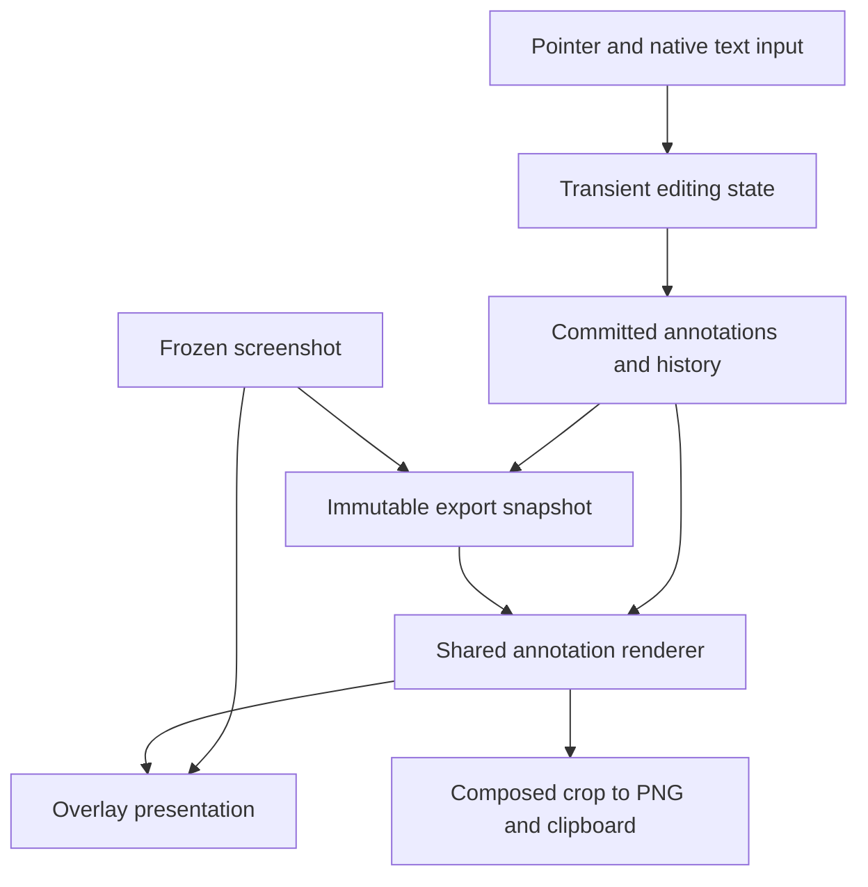
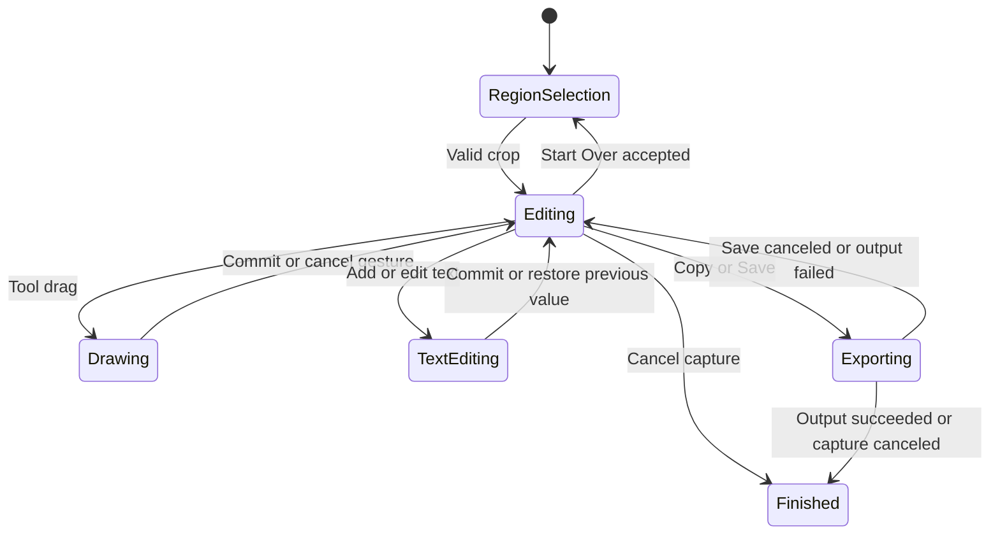

## Goal Capsule

Add drawing and text directly to the frozen screenshot selection, then copy or save the composed PNG without opening a separate editor.
Build on the accepted milestone 1 capture loop, including full Retina resolution, window shadows, Command–Shift–7, and stable Apple Development signing.
This plan authorizes local implementation when the user requests it; no commit, publishing, or Google integration is part of this pass.
Finish with automated verification and real desktop checks, reporting any unverified behavior explicitly.

## Product Contract

### Scope and origin

The milestone 1 roadmap deferred freehand drawing, arrows, shapes, text comments, color selection, and undo/redo to this milestone (see `docs/plans/2026-10-01-2032-feat-milestone-one-capture-plan.md`).
The user accepted milestone 1 after verifying the resolution and shadow fixes.
Details below are proposed defaults for milestone 2, rather than previously confirmed product choices.

### Requirements

**Editing tools**

- R1. After releasing a rectangular selection, show annotation tools beside Copy, Save, and Cancel within the existing overlay.
- R2. Provide Pen, Arrow, Line, Rectangle, Ellipse, and Text. Preview drawing continuously during a drag and commit one annotation on release.
- R3. Offer a compact color palette and three stroke widths. Use red and a medium width initially; style changes affect subsequent drawings, or the selected annotation when one exists.
- R4. Text is plain, multiline, left-aligned text in a system font. Offer three font sizes, with medium initially. Support Unicode and native input methods.
- R5. A Select tool lets users select, move, recolor, and delete committed annotations. Double-clicking selected text reopens its editor. Preserve stacking order; the last added annotation is on top.

**Interaction and recovery**

- R6. Lock the capture rectangle after selection. Drawing never changes it. An explicit Start Over action returns to region selection on the same frozen screenshot; confirm before discarding existing annotations.
- R7. Clip annotations and their previews to the selected rectangle. Annotation coordinates are relative to that rectangle, so display origin and Retina scale cannot shift them.
- R8. Undo/redo covers creation, movement, deletion, style changes, and committed text edits. One drag or committed text edit is one history entry; a new edit after undo clears redo. Tool and default-style changes alone do not enter history.
- R9. Escape cancels an in-progress drawing or text edit first, then clears an annotation selection, then cancels capture. Native save-panel Escape continues to cancel only that panel.
- R10. Text editing owns normal text shortcuts, including Copy and Undo. Toolbar Copy/Save commits nonempty text before export; empty text is discarded. Plain Return inserts a newline; Command–Return or clicking outside commits. Escape restores the text's previous committed value.

**Output and responsiveness**

- R11. Copy and Save produce identical composed image content at the original crop's pixel dimensions. Include committed annotations; exclude editor chrome, selection handles, dimming, capture border, and toolbar.
- R12. A canceled save or failed output preserves the screenshot, annotations, styles, and history for retry. During export, disable editing and duplicate outputs; retain the existing session cancellation checks.
- R13. Drawing stays responsive without recapturing or encoding images during pointer movement. Ended sessions release annotation data and pending edits along with capture buffers.

### Proposed defaults

Pen is active initially. Rectangle and ellipse are outline-only; arrow has one arrowhead. Palette: red, yellow, green, blue, white, and black. Widths: 2, 4, and 8 logical points. Font sizes: 16, 24, and 32 logical points.
Select chooses the topmost hit annotation, using stroke-distance hit testing with a small tolerance rather than an entire freehand bounding box. Delete removes the selected annotation only while the text editor is inactive.
Zero-length lines and shapes and empty pen gestures create no annotation or history entry. Switching tools cancels an unfinished drag; committed drawings remain.
Start Over clears annotations and history, retaining the current session's frozen display images. Canceling its confirmation preserves everything.

### Deferred to follow-up work

Google sign-in, Drive folder/uploads, anyone-with-link sharing, copied links, and gallery remain milestone 3.
Annotation resizing/rotation, z-order controls, rich text, shape fills, highlighter, blur/redaction, OCR, zoom, saved defaults, capture resizing/moving, and editable document persistence are deferred.
This pass exports flattened PNGs and stores no screenshots or annotation documents automatically.

### Acceptance examples

- AE1. Capture a region, draw a red arrow, add two lines of text, undo and redo the text, then copy. The pasted image shows the same marks without toolbar or handles.
- AE2. Draw on a 2× Retina crop. A 4-point line exports with an 8-pixel width and retains the exact background crop dimensions.
- AE3. Move a rectangle partly beyond the crop. Its preview and output are clipped identically; undo restores its original position.
- AE4. Edit existing text and press Escape. Its old text is restored; the screenshot remains open. A later Escape with no transient edit or selection cancels capture.
- AE5. Cancel Save, then undo an annotation and choose Copy. The frozen screenshot and remaining annotations persist throughout.

## Planning Contract

### Current integration points

`CaptureCoordinator` owns session lifetime and asynchronous output. `CaptureSession` tracks selecting/ready/exporting and discards stale results by session UUID.
`CaptureOverlayView` currently treats a new ready-state drag as crop replacement; this must become explicit Start Over to avoid erasing work.
`CaptureToolbar` is currently fixed at 244×48. `SelectionGeometry.toolbarFrame` places a single toolbar within usable display bounds.
`ScreenshotExporter` crops the immutable full-resolution image and encodes PNGs. Extend its output boundary to accept annotations; preserve the unannotated path exactly.
There are 21 existing tests. They cover capture configuration, session transitions, geometry, and output; annotation behavior needs new coverage.

### Key technical decisions

- KTD1. Keep AppKit and the existing overlay. Use a selection-local annotation document containing value-based objects, stable IDs, styles, and ordered geometry. Keep the untouched screenshot separate. No external dependencies or generalized editor framework.
- KTD2. Separate committed document state from transient gesture previews, selected-object handles, and active text editing. Maintain a small document history of before/after edit states; coalesce whole user operations rather than recording pointer events. Text input retains native character-level undo until commit, then becomes one document edit.
- KTD3. Use one renderer for annotation geometry in the overlay and export. Render into a crop-sized bitmap using actual crop-to-logical x/y scale and a single explicit axis convention. Account for outward-rounded crop origin so fractional selections do not shift marks. Share arrowhead, stroke, clipping, and text-layout calculations.
- KTD4. Use a temporary native `NSTextView` for input, with explicit responder ownership and matching font, width, wrapping, and line spacing in export. Do not rasterize the on-screen editor or use its selection/caret in output.
- KTD5. Keep editing substate out of the capture session's lifecycle enum. The coordinator owns a session-local annotation document and hands the view its editing operations; export receives an immutable document snapshot. Clear it when capture ends or Start Over succeeds.
- KTD6. Split annotation controls and output actions into compact floating groups. Keep active tool visibly selected, provide tooltips/accessibility labels, show undo availability, and clamp placement to the active display's usable bounds. On small selections, controls may overlap the crop but are never exported; use compact overflow when the available width is insufficient.

### High-level technical design

These diagrams show ownership and interaction boundaries, not prescribed class signatures.

Toolbar output resolves active text editing before export. Output during an unfinished pointer drag is unavailable. Transient editing never enters the exported document.

### Risks and checks

Keyboard routing is the main interaction risk: Command–C must copy text while typing and copy the screenshot otherwise. Undo follows the same ownership rule. Avoid tool letter shortcuts in this pass to keep text input predictable.
Screen/export parity is the main rendering risk: test Retina and fractional crop alignment, text wrapping, clipping, and arrowheads with pixel fixtures. Native text input and visual equality still require desktop checks.
Long strokes can increase redraw cost. Store only distinct points, redraw the affected region, and avoid full-image compositing per event. Add complexity only if measurement identifies a bottleneck.
Preserve source capture and signing settings so annotation work does not reintroduce fuzzy images, missing shadows, or permission invalidation.

## Implementation Units

### U1. Annotation document and history

Requirements: R2–R5, R7–R8, R13. Files: new `Snap/Annotation.swift`, `Snap/AnnotationDocument.swift`, and `SnapTests/AnnotationDocumentTests.swift`; test-target membership in `Snap.xcodeproj/project.pbxproj`.
Define value-based geometry and styles, ordered IDs, document edits, and undo/redo. Keep transient input outside history.
Test one-entry drag edits, undo/redo for each operation, redo invalidation, empty edits, overlapping-object selection, and reset between captures. Use deterministic tests before wiring event handling.

### U2. Shared rendering and composed output

Requirements: R7, R11–R12; AE2–AE3. Depends on U1.
Files: new `Snap/AnnotationRenderer.swift`, `SnapTests/AnnotationRendererTests.swift`; extend `Snap/ScreenshotExporter.swift` and `SnapTests/ScreenshotExporterTests.swift`.
Render each tool and committed text onto both preview contexts and a correctly scaled export bitmap. Preserve source pixels outside annotated areas and bypass recompositing when the document is empty.
Test colored strokes and shapes over known backgrounds, arrowhead endpoints, clipping, 1×/2× dimensions, fractional crop alignment, text layout, and absence of selection chrome. Decode the PNG to verify pixels and dimensions; Copy and Save use the same composition function.

### U3. Drawing interaction and toolbar

Requirements: R1–R3, R5–R7, R9, R13; AE1, AE3. Depends on U1–U2.
Files: `Snap/CaptureOverlayView.swift`, `Snap/CaptureToolbar.swift`, `Snap/SelectionGeometry.swift`, `Snap/CaptureCoordinator.swift`; new `Snap/AnnotationInteraction.swift`, `SnapTests/AnnotationInteractionTests.swift`; extend placement tests.
Separate crop selection from annotation gestures, add tool/style controls and Select, implement movement/deletion, and make Start Over explicit. Keep selection fixed and constrain drawing input to the selected display. Start Over confirmation appears above overlay panels.
Test reversed shape drags, gestures crossing crop bounds, movement undo, zero-area gestures, switching tools during a gesture, topmost hit selection, and Start Over accept/cancel. Manually check toolbar hit targets and placements on tiny crops and each screen corner.

### U4. Native text input and keyboard routing

Requirements: R4–R5, R8–R10; AE1, AE4. Depends on U3.
Files: new `Snap/AnnotationTextEditor.swift`; extend `Snap/CaptureOverlayView.swift`, `Snap/CaptureCoordinator.swift`, and interaction tests.
Provide add/edit text with commit/cancel behavior, matching preview/export layout, and native responder handling. Toolbar output commits nonempty edits. Do not intercept text editor Command–C, Command–Z, selection, paste, or composition input.
Test committed text as one document operation, cancel restoring old text, empty new text, output resolving text editing, and ordered Escape behavior. Manually verify multiline Unicode text, input methods, text selection/copy, character undo, and document undo after commit.

### U5. Output integration and desktop verification

Requirements: R6, R8–R13; AE1–AE5. Depends on U1–U4.
Files: `Snap/CaptureCoordinator.swift`, `Snap/CaptureSession.swift`, `SnapTests/CaptureSessionTests.swift`, `README.md`, new `docs/verification/milestone-two.md`.
Capture immutable annotation state before asynchronous export; retain document/history on failed or canceled output. Clear all editing state and responder references on session end and display-layout changes.
Test stale/canceled exports, duplicate output protection, save cancellation retaining edits, and complete session reset. On the real desktop, verify all acceptance examples, sharp source pixels/shadows, prior-app focus, and drawing responsiveness.

## Verification Contract

Run the shared Snap scheme's full XCTest suite using Xcode, the configured development signing, and `.build/xcode` derived data. Verify the built signature before relaunching. No new dependencies or installations are anticipated.
Use fixture-based tests for document/history, interaction state, geometry, and composed PNG output; tests must not alter the real clipboard or take live screenshots.
Real desktop checks cover drawing, text responder behavior, Copy/paste into another app, Save cancellation, Start Over confirmation, Escape hierarchy, fullscreen use, and available mixed-scale displays.
Measure drawing input-to-visible-preview with a 10-second stroke and at least 20 alternating gestures on the development Mac; investigate visible stalls. Proposed target is p95 within two display refresh intervals, measured visually with Instruments as supporting evidence. This is an unverified target, not a promise based on event-handler timing.
Record actual results and unavailable hardware/OS cases in `docs/verification/milestone-two.md`.

## Definition of Done

All six annotation tools work directly on the selected screenshot. Style controls, Select/move/delete, text editing, and undo/redo follow the interaction contract.
Copy and Save preserve full-resolution screenshot detail and include identical committed annotations without UI chrome.
Save cancellation and output failures preserve the editable document; ended sessions leave no annotations, text editors, or stale callbacks behind.
Automated checks pass and the user verifies the desktop workflow. Any unresolved visual or performance problem is reported before claiming completion.
Google Drive and annotation features explicitly deferred above remain outside this pass.

## Sources

- Existing capture contract: `docs/plans/2026-10-01-2032-feat-milestone-one-capture-plan.md`.
- Verified capture corrections and desktop acceptance: `docs/verification/milestone-one.md`.
- [Apple AppKit drawing](https://developer.apple.com/documentation/appkit/drawing) and [path drawing](https://developer.apple.com/documentation/appkit/nsbezierpath).
